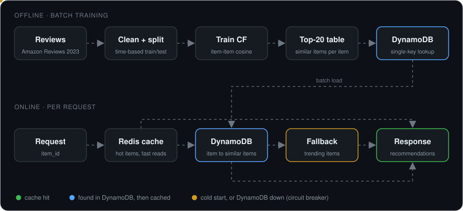
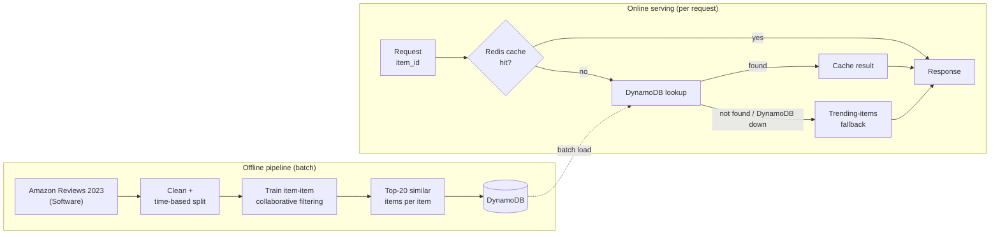
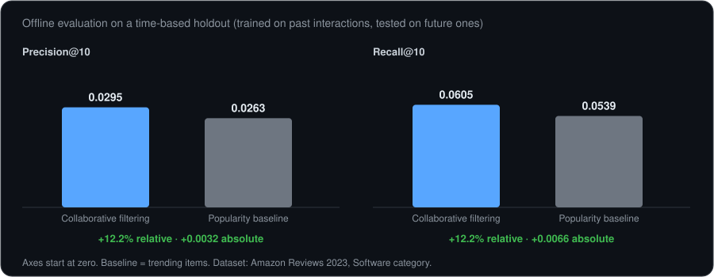
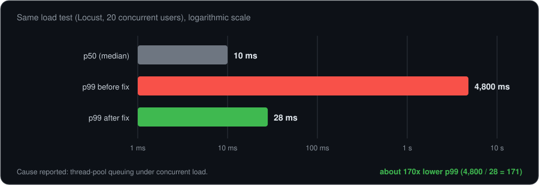
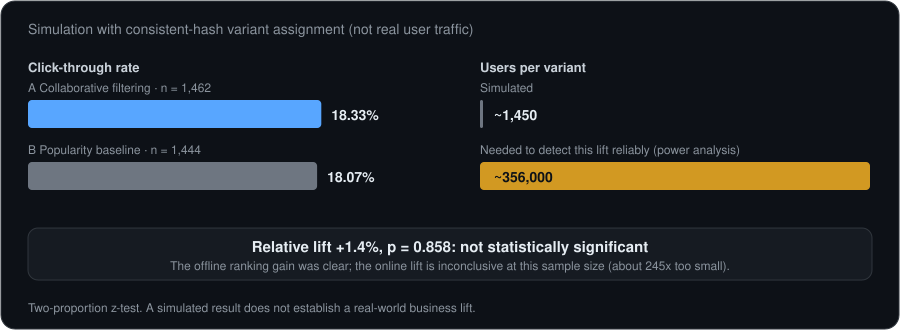

# Amazon-Style Recommendation Engine

**Item-item collaborative filtering with a cached serving layer and tested fallbacks**

> Independent portfolio project, inspired by the item-to-item collaborative filtering approach Amazon described in 2003. It is not affiliated with, endorsed by, or sponsored by Amazon.

This project builds the full path from model to serving. An item-item model is trained offline on Amazon Reviews 2023 (Software category), the precomputed similarities are loaded into DynamoDB, and a FastAPI service answers requests through a Redis cache with fallbacks for failures and unknown items. The model is evaluated offline against a popularity baseline, the API is load-tested with Locust, and a simulated A/B test compares the two approaches.



[Screenshots](#screenshots) · [Architecture](#architecture) · [Results](#results) · [Engineering decisions](#engineering-decisions) · [Run locally](#run-locally) · [Limitations](#limitations-and-evidence-notes)

**Stack:** Python, pandas, scikit-learn, SciPy (sparse matrices), FastAPI, Redis, DynamoDB Local, PostgreSQL, Docker, Locust, plain HTML/JS frontend.

---

## Screenshots

<table>
  <tr>
    <td width="33%"><a href="https://github.com/user-attachments/assets/47ad58e6-7eb3-464d-aa4e-fb644dbd8a43"></a></td>
    <td width="33%"><a href="https://github.com/user-attachments/assets/dc25425d-1578-4117-beef-e46c2d7d5ac0"></a></td>
    <td width="33%"><a href="https://github.com/user-attachments/assets/6caf961e-f4d6-4f96-beca-64669d4fff2e"></a></td>
  </tr>
  <tr>
    <td align="center"><sub>Demo frontend (click to enlarge)</sub></td>
    <td align="center"><sub>Demo frontend (click to enlarge)</sub></td>
    <td align="center"><sub>Demo frontend (click to enlarge)</sub></td>
  </tr>
</table>

---

## The problem

When a customer looks at a product, what else should the page show them? Item-item collaborative filtering answers this by comparing **items** to each other, based on which users interacted with both, instead of comparing users to each other. Item relationships change slowly while user behaviour changes constantly, so item similarities can be computed ahead of time and served cheaply.

This project implements that algorithm, then wraps it in the serving pieces a real product needs: a fast key lookup, a cache, and fallback behaviour for new items and failing dependencies.

---

## Architecture



<details>
<summary>Text version of the diagram (Mermaid, editable in <code>docs/architecture.mmd</code>)</summary>



</details>

**Why training and serving are separate.** Training is slow and can run on a schedule. Serving has to answer in milliseconds. So similarities are precomputed offline (top 20 per item) and the online path is a single-key lookup, with Redis in front for hot items. PostgreSQL is part of the stack for relational and analytical data (interaction history, evaluation logs); it is not on the request path.

---

## Results

All numbers below come from this project's own experiments. The serving measurements are from a local setup using DynamoDB Local. None of them are production figures or service-level guarantees.

### Offline model quality



| Model | Precision@10 | Recall@10 |
|---|---|---|
| **Item-item collaborative filtering** | **0.0295** | **0.0605** |
| Popularity baseline (trending items) | 0.0263 | 0.0539 |
| Relative improvement | +12.2% | +12.2% |
| Absolute difference | +0.0032 | +0.0066 |

The split is **temporal**: the model trains only on past interactions and is evaluated on future ones, which avoids look-ahead bias. The improvement is real but modest in absolute terms, so I report both the relative and absolute differences.

### Serving performance and tail latency

Load test with [Locust](https://locust.io), 20 concurrent users:

| Metric | Value |
|---|---|
| Median latency (p50) | 10 ms |
| p95 latency | 20 to 28 ms |
| p99 latency | 27 to 31 ms |
| Throughput | 63.6 requests/sec |
| Failed requests | 0% |



**What went wrong first.** The first load test showed a median of 10 ms but a p99 of **4,800 ms**. That gap is the signature of requests queuing behind each other: FastAPI's synchronous handlers run in a thread pool, and under concurrent load that pool was starved. After changing the concurrency configuration, p99 dropped to about 28 ms (roughly 170x lower). The lesson was to look at the tail, because the median looked healthy the whole time.

### Fault tolerance

Each failure below was tested by stopping the dependency while the system was running, not only written as a code path.

| Scenario | Behaviour |
|---|---|
| Redis unavailable | Skips the cache and serves directly from DynamoDB, with no error to the user |
| DynamoDB unavailable | Falls back to trending items after 3 failed attempts, then stops retrying for a cooldown period (circuit breaker) so a dead dependency is not hammered |
| Item not in the model (cold start) | Falls back to trending items automatically |

### A/B test simulation: offline gain versus online lift



| Variant | Users | CTR |
|---|---|---|
| A: collaborative filtering | 1,462 | 18.33% |
| B: popularity baseline | 1,444 | 18.07% |
| Relative lift | | +1.4% |

Users are assigned to variants by consistent hashing, so the same user always sees the same variant. A two-proportion z-test gives **p = 0.858, which is not statistically significant**. A power analysis explains why: detecting a lift this small reliably needs on the order of 356,000 users per variant, about 245 times the simulated sample.

The offline metric showed a clear improvement while the simulated online metric was inconclusive. That is a realistic reason to track both, and this simulation does **not** establish a real-world business lift.

---

## Engineering decisions

- **Item-item rather than user-user.** Item relationships are more stable than user behaviour, so they can be precomputed and cached.
- **Offline precompute, online lookup.** Keeps the request path to one key lookup and lets retraining run independently.
- **Redis and DynamoDB have different jobs.** DynamoDB holds the full similarity table behind a predictable single-key lookup (`item_id` to similar items). Redis only holds hot items in front of it.
- **PostgreSQL for relational work.** Interaction history and evaluation logs suit joins and aggregations, which the key-value store is not built for.
- **Fallbacks are part of the design.** Unknown items, a missing cache, and a dead database each have a defined behaviour, and a circuit breaker stops repeated calls to a failing dependency.
- **Measure the tail, not the average.** The p99 spike was invisible in the median and was found only through load testing.
- **Report offline and online results separately,** and say plainly when an experiment is underpowered.

---

## Code structure

The serving layer is split into small modules, each with one responsibility:

```
storage/
  cache.py                 # Redis: knows nothing about DynamoDB or recommendations
  dynamo_repository.py     # DynamoDB: knows nothing about caching or recommendations
recommendation/
  strategies.py            # Strategy pattern: CollaborativeFilteringStrategy, TrendingFallbackStrategy
  service.py               # Orchestrates cache -> strategies via dependency injection
api/
  main.py                  # Routing only: wires dependencies together at startup
```

- **Single responsibility:** each module owns one concern (Redis, DynamoDB, or orchestration).
- **Strategy pattern:** both strategies implement the same interface and can be swapped without touching the caller.
- **Dependency injection:** `RecommendationService` receives its cache and strategies as constructor arguments, which makes it testable with fake dependencies.

---

## Run locally

**Prerequisites:** Docker and Python 3.10+. Download the Software-category review file from [Amazon Reviews 2023](https://amazon-reviews-2023.github.io/) and place it at `data/raw/reviews.jsonl`, the path step 3 reads.

```bash
# 1. Start infrastructure
docker compose up -d

# 2. Install dependencies
pip install -r requirements.txt

# 3. Process the data (raw reviews -> clean train/test split)
python ml/data_loader.py --input data/raw/reviews.jsonl --output data/processed/interactions.parquet

# 4. Train the model and evaluate against the baseline
python ml/similarity_engine.py --train data/processed/interactions_train.parquet --test data/processed/interactions_test.parquet --output data/processed/item_similarity.parquet

# 5. Load the model into DynamoDB
python ml/dynamo_writer.py --input data/processed/item_similarity.parquet

# 6. Run the A/B test simulation
python ml/ab_test_simulation.py --train data/processed/interactions_train.parquet --test data/processed/interactions_test.parquet --similarity data/processed/item_similarity.parquet

# 7. Start the API (port 8001)
uvicorn api.main:app --host 0.0.0.0 --port 8001 --limit-concurrency 100

# 8. Open frontend/index.html in a browser for the interactive demo
```

**Troubleshooting**

- **Only trending items come back after a restart.** DynamoDB Local runs in memory for this project, so its data is cleared whenever the container restarts. Re-run step 5 after any `docker compose restart`.
- **A step cannot find an input file.** Run every command from the repository root, and check that the previous step wrote its output under `data/processed/`.
- **Redis is down.** This is expected to work: the API skips the cache and serves from DynamoDB.

---

## Limitations and evidence notes

- Serving numbers come from one local setup with **DynamoDB Local**, not AWS. They show the shape of the behaviour (and the tail-latency fix), not production capacity.
- The A/B test is a **simulation**, not real traffic, and its lift is not statistically significant.
- Offline metrics are low in absolute terms and compare against a simple trending-items baseline only.
- Similarity is computed by brute-force cosine similarity, which is fine for roughly 5K items. User-level recommendations are a simplified fallback.

### What I would change at a larger scale

- **Similarity computation:** use approximate nearest-neighbour search (FAISS or pgvector) instead of a full pairwise matrix.
- **User-level recommendations:** look up a user's recent history in Postgres and feed it through the same strategy.
- **DynamoDB access patterns:** add a Global Secondary Index or a second table, designed access-pattern-first.
- **Async I/O:** move to `redis.asyncio` and `aioboto3` to remove the thread-pool bottleneck instead of tuning around it.
- **Retraining:** schedule it (for example nightly with Airflow or cron) and monitor for model staleness.

---

## Dataset

[Amazon Reviews 2023](https://amazon-reviews-2023.github.io/), Software category. Users and items with fewer than 10 interactions are filtered out before training. The train/test split is by timestamp, not random, to avoid training on future data relative to the test set.
